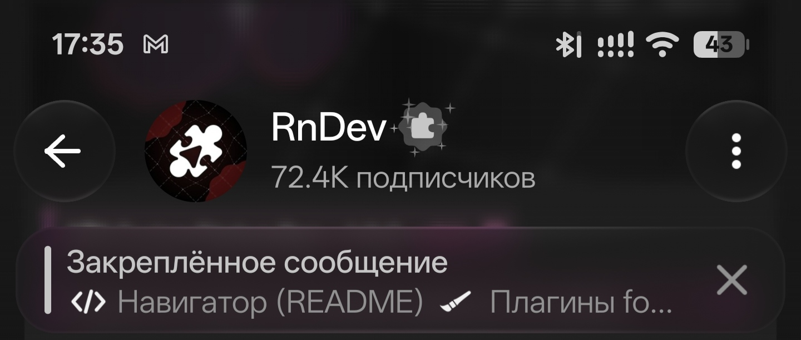
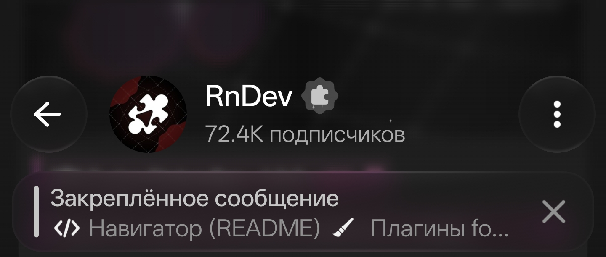

# Bar Swipe

<a href="README.ru.md"><kbd>Русский</kbd></a>

Bar Swipe is an LSPosed module that hides the Android status bar with an upward swipe and brings it back with a downward swipe.

[Download APK](https://github.com/Xposed-Modules-Repo/dev.rooni.barswipe/releases/latest)

| Status bar visible | Status bar hidden |
| --- | --- |
|  |  |

## Usage

Requires Android 13 or later and LSPosed with modern Xposed API 101 support. Enable the module for System UI (`com.android.systemui`) and reboot.

Swipe up on the status bar to hide it. Swipe down from the same area to restore it, then swipe again to open the notification shade.

## Build

Use JDK 21 and Android SDK Platform 35. Set `ANDROID_HOME` to your SDK path.

```sh
./gradlew assembleDebug
```

On Windows, run `gradlew.bat assembleDebug`. The APK is at `app/build/outputs/apk/debug/app-debug.apk`.

Author: [YouRooni.t.me](https://t.me/YouRooni)
