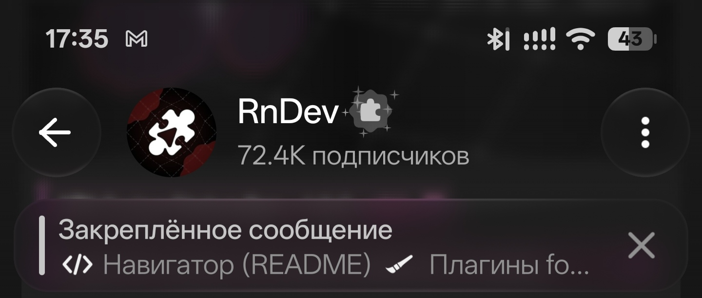
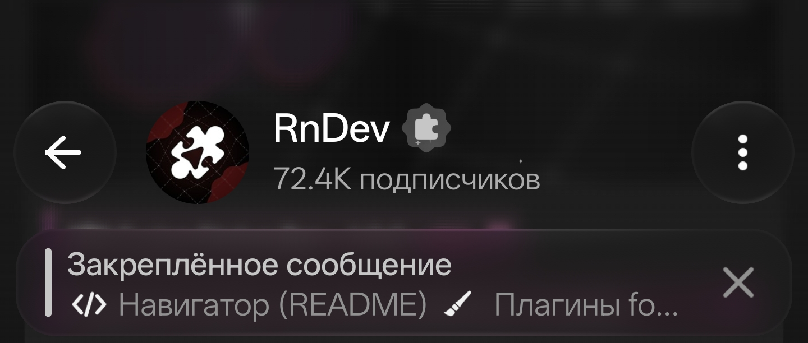

# Bar Swipe

<a href="README.md"><kbd>English</kbd></a>

Bar Swipe — модуль для LSPosed, который скрывает статус-бар Android свайпом вверх и возвращает его свайпом вниз.

[Скачать APK](https://github.com/Xposed-Modules-Repo/dev.rooni.barswipe/releases/latest)

| Статус-бар виден | Статус-бар скрыт |
| --- | --- |
|  |  |

## Использование

Нужны Android 13 или новее и LSPosed с поддержкой современного Xposed API 101. Включите модуль для System UI (`com.android.systemui`) и перезагрузите устройство.

Смахните статус-бар вверх, чтобы скрыть его. Свайп вниз оттуда же вернёт статус-бар, а следующий откроет шторку.

## Сборка

Понадобятся JDK 21 и Android SDK Platform 35. Укажите путь к SDK в `ANDROID_HOME`.

```sh
./gradlew assembleDebug
```

На Windows запустите `gradlew.bat assembleDebug`. APK появится в `app/build/outputs/apk/debug/app-debug.apk`.

Код модуля: [лицензия MIT](LICENSE) · Автор: [YouRooni.t.me](https://t.me/YouRooni)
